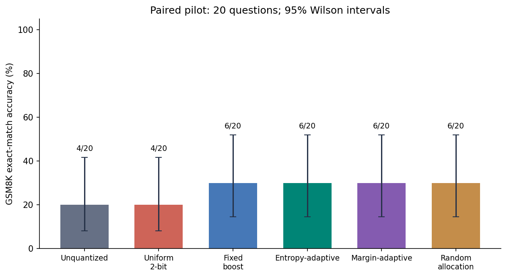
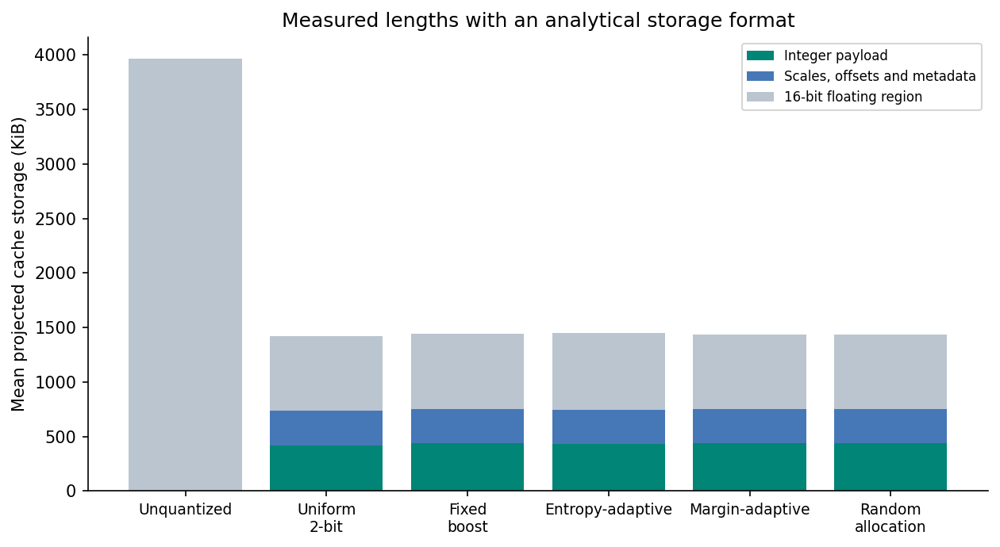
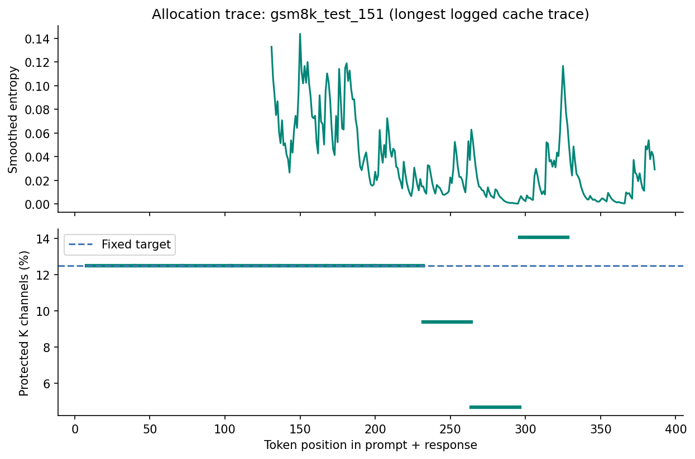
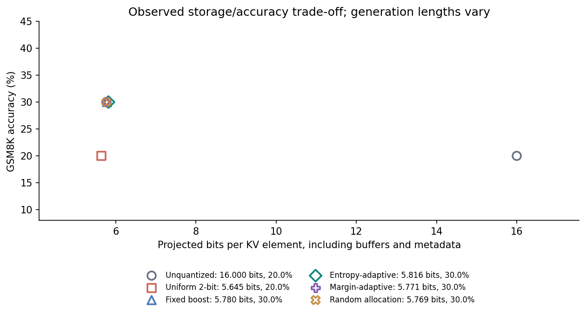
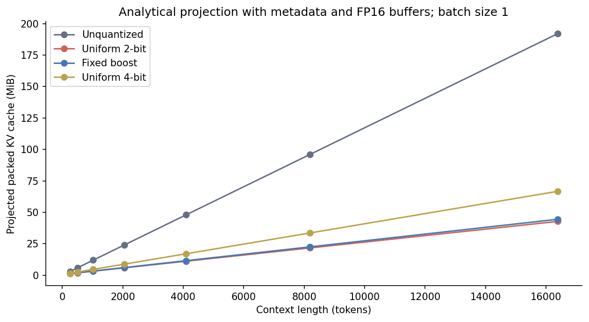
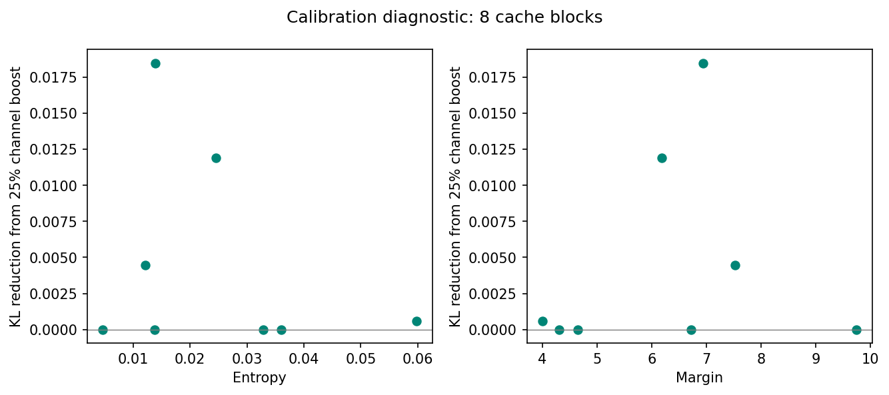

# Reasoning-Adaptive Key-Value Cache Compression (RA-KVC)

Uncertainty-guided precision allocation under a storage budget

DA4022 Hardware-Aware Deep Learning, IIT Guwahati

**Evidence status:** complete; 20 paired GSM8K questions; model Qwen/Qwen2.5-0.5B-Instruct.

**Team:** Kondapi Venkata Dhruv (230122024); Mathangi Venkatraman Srinivasan (230121037); Venkat Sai Teja Kalluri (230121032); Sanjay G (230121049); Vipul Sharma (230103117)

## Abstract

The KV cache stores the key and value representations needed for autoregressive language-model generation. Low-bit quantization reduces its potential storage cost but can change the model's outputs. This project studies whether output uncertainty can guide a time-varying allocation of extra precision while constraining the total protection budget.

We implement RA-KVC as a PyTorch fake-quantization prototype and compare policies on Qwen/Qwen2.5-0.5B-Instruct using 20 paired GSM8K test questions. The shared quantizer uses 2-bit keys and values with selected key channels at 4 bits. Entropy and logit-margin variants change the protection fraction for generated token blocks. A credit controller limits cumulative allocation, and an explicit storage model includes metadata and floating buffers.

Entropy-adaptive allocation differed from fixed allocation by +0.0 percentage points on this cohort. The paired bootstrap interval for this difference was [+0.0, +0.0] percentage points. This interval includes zero and does not establish an improvement. Both policies have identical correctness on every sampled question. The resulting degenerate bootstrap interval does not establish equivalence.

A post-pilot length diagnostic changes the unquantized cap from 256 to 512 tokens. Correct answers change from 4/20 to 10/20, while truncated responses change from 14 to 1. This highlights generation length as a confounder; the longer-cap diagnostic does not compare adaptive policies.

The findings are exploratory. Accuracy is measured from actual generated answers. Packed-cache memory is an analytical projection, while the implementation retains floating tensors. The study does not demonstrate production speedup, real INT2 memory allocation, or a general ability to detect reasoning.

## 1. Introduction and research question

An autoregressive transformer repeatedly attends to earlier token representations. Caching keys and values avoids recomputing those representations, but the cache grows with sequence length. For grouped-query attention, storage depends on the number of KV heads, which can be smaller than the number of query heads. A hardware-aware evaluation must therefore account for model dimensions, context length, precision and representation overhead.

Kitty [1] motivates protecting selected key channels at higher precision while keeping most cache values at 2 bits. Its channel choices already adapt to the contents of each group. Our research question concerns a different decision: can the fraction of channels protected in each generated block vary usefully with output uncertainty? We use a simplified Kitty-inspired baseline and do not claim a reproduction of its optimized kernels or complete configuration.

The initial proposal described entropy as a reasoning-demand signal. Here it is treated as a hypothesis. A model can be uncertain for reasons unrelated to reasoning, and a confidently generated token may still need accurate retention. We therefore measure both answer accuracy and a local cache-sensitivity diagnostic.

The central comparison keeps the model, prompts, quantizer, channel ranker and buffer layout the same. Fixed allocation protects a constant fraction of key channels in every eligible block. Adaptive allocation changes that fraction only for blocks made entirely of generated tokens. HumanEval, when included, is a secondary coding task rather than an easy non-reasoning control.

## 2. Quantization and uncertainty signals

For a group x with minimum l and maximum u, an affine b-bit quantizer uses scale s=(u-l)/(2^b-1) and reconstructs x_hat=l+s*clip(round((x-l)/s), 0, 2^b-1). Constant groups are preserved exactly. K groups reduce over token positions within a block, while V groups reduce over channels within a token. Computation uses FP32 before returning to the cache dtype.

The mixed-precision method ranks key channels by their mean absolute magnitude within the block, independently for each layer and KV head. Its highest-ranked channels use 4 bits, while the remaining key channels and the values use 2 bits. Fixed and adaptive policies share this rule. Only the number of protected channels changes.

Normalized entropy is H=-sum(p log p)/log(V), where V is vocabulary size. The margin is the largest minus second-largest raw logit. Larger entropy and smaller margin both indicate greater uncertainty. The implementation records the uncertainty that predicted a token at that token's absolute position and smooths the signal with an exponential moving average.

The smoothing coefficient is 0.3. Calibration uses 4 predetermined GSM8K training questions, disjoint from the test cohort. Mean and standard deviation of the smoothed signals define a standardized score, clipped to [-1,1]. The margin's sign is reversed. A block uses the average signal of its tokens.

The model already produces logits, but the entropy reduction, top-two selection, smoothing and controller still cost time. These operations are included in the measured simulation runtime. No zero-overhead claim is made.

## 3. Causal cache operation and budget control

The cache retains the first 8 tokens and at least the most recent 32 tokens in floating precision. Eligible tokens form groups of 32. A trailing incomplete group remains floating. Each new block is finalized after a forward pass and before the next forward pass, so quantization affects subsequent attention. Already finalized blocks are never requantized or retroactively promoted.

Prompt blocks and blocks crossing the prompt/response boundary use fixed protection in every mixed-precision method. Adaptation starts only for wholly generated blocks. This prevents prompt processing from introducing an unrelated difference between fixed and adaptive variants.

The nominal protection fraction is r=0.125. For head dimension D, each newly finalized generated block earns rD credits. The controller requests round(rD*(1+z)) protected channels, where z is clipped uncertainty. It cannot spend future credits. A lower allocation bound also prevents the unspent balance from growing beyond approximately one nominal block budget.

This design guarantees that cumulative generated-block protection does not exceed its target, apart from numerical tolerance. It does not guarantee exact equality when generation ends: unused credit can remain at EOS or the token limit. Integer channel counts, incomplete blocks and realized storage are explicitly reported. A nominally shared target alone is insufficient to establish an equal-memory improvement.

The random control replaces the uncertainty score with a seeded random score and keeps the same controller and channel ranker. The rapid study uses one random seed. It is a diagnostic control, not a robust average over many random schedules.

| Policy | Eligible keys | Eligible values |
| --- | --- | --- |
| Unquantized | Original floating dtype | Original floating dtype |
| Uniform 2-bit | All channels at 2 bits | 2 bits |
| Fixed boost | Fixed fraction at 4 bits | 2 bits |
| Entropy / margin | Credit-constrained variable fraction | 2 bits |
| Random allocation | Random score under the same controller | 2 bits |

## 4. Experimental protocol

The test cohort is a deterministic shuffled subset of GSM8K [3]. All methods see the same questions and the same chat prompt. The prompt requests a concise step-by-step solution ending with an explicit numeric answer marker. Greedy decoding avoids sampling variation. The runner saves text, token IDs, answer extraction, cache allocations, timing and storage accounting for every method/question pair.

Numeric exact match is the primary metric. The scorer prioritizes the explicit answer marker and boxed/final-answer forms. For completed generations only, it can fall back to the last number. A truncated response without an explicit final answer is counted as incorrect instead of treating an intermediate number as its answer. Truncation and missing-answer counts are reported.

Accuracy intervals use the Wilson method. Comparisons with fixed allocation use a paired bootstrap over question identities, with discordant-pair counts and an exact McNemar test in the saved summary. Small-sample intervals are descriptive and cannot support broad generalization. Analysis includes only questions completed by every configured method; the status below records whether the requested cohort completed.

The small model and short generation cap are practical scope reductions from the original proposal. Larger GPU configurations are included for replication, but they are not presented as completed experiments. CPU latency measures this Python simulation, not the performance of a packed low-bit inference engine.

| Setting | Executed value |
| --- | --- |
| Model | Qwen/Qwen2.5-0.5B-Instruct |
| Model revision | 7ae557604adf67be50417f59c2c2f167def9a775 |
| Device / weight dtype | cpu / torch.float32 |
| Test questions | 20 paired of 20 planned (complete) |
| Calibration / test split | 4 train / 20 test questions |
| Maximum generated tokens | 256 |
| Layers / KV heads / head dimension | 24 / 2 / 64 |
| PyTorch / Transformers | 2.6.0+cpu / 4.46.3 |
| Seed | 17 |

## 5. GSM8K results

The following values are calculated from the saved generated answers. They are measurements of this configuration and selected cohort, not expected values copied from prior work.

Entropy-adaptive allocation differed from fixed allocation by +0.0 percentage points on this cohort. The paired bootstrap interval for this difference was [+0.0, +0.0] percentage points. This interval includes zero and does not establish an improvement. Both policies have identical correctness on every sampled question. The resulting degenerate bootstrap interval does not establish equivalence.

Quantization can occasionally change a wrong answer into a correct one, so the unquantized score is a reference rather than a guaranteed upper bound. Conversely, an apparent gain can reflect response-length changes or chance on a small cohort. The raw answers and truncation counts allow these cases to be inspected.

| Method | Correct | Accuracy | 95% interval | Truncated |
| --- | --- | --- | --- | --- |
| Unquantized | 4/20 | 20.0% | 8.1% - 41.6% | 14 |
| Uniform 2-bit | 4/20 | 20.0% | 8.1% - 41.6% | 15 |
| Fixed boost | 6/20 | 30.0% | 14.5% - 51.9% | 13 |
| Entropy-adaptive | 6/20 | 30.0% | 14.5% - 51.9% | 13 |
| Margin-adaptive | 6/20 | 30.0% | 14.5% - 51.9% | 13 |
| Random allocation | 6/20 | 30.0% | 14.5% - 51.9% | 13 |

## 5.1. Generation-length diagnostic

The short-cap pilot produced many unfinished responses. We therefore added an unquantized reference run with a larger generation cap on the same predetermined questions. This is a post-pilot diagnostic, not an independently selected confirmation study. Model weights, prompt, greedy decoding and the calibration split remain unchanged.

The table isolates the generation-limit change within the unquantized policy. It helps determine whether low short-cap scores reflect missing final answers. Fixed and adaptive policies were not evaluated at the larger cap in this diagnostic, so the longer-reference result must not be compared with their short-cap scores as an equal-protocol compression result.

A stronger follow-up should rerun every compared policy with a cap that permits complete answers. The supplied rapid GPU configuration allows 512 new tokens for this reason.

| Reference run | Questions | Correct | Accuracy | Truncated |
| --- | --- | --- | --- | --- |
| 256-token cap | 20 | 4 | 20.0% | 14 |
| 512-token cap | 20 | 10 | 50.0% | 1 |

## 6. Storage accounting and allocation behavior

With fraction r of keys protected, payload precision averages 2+2r bits for K and 2 bits for V, hence 2+r bits across both. At r=0.125 this is 2.125 bits before representation overhead. A 32-token, 64-channel group for one layer/head needs 1088 payload bytes plus 784 metadata bytes: 3.65625 bits per K/V scalar before floating buffers, versus 8192 bytes for that group at 16 bits.

Our specified packed format adds two FP32 parameters per K channel and V token, a channel bitmap, an eight-byte per-head block descriptor, and 16-bit floating buffers. The table includes these costs. Effective bits aggregate estimated bytes over observed cache elements, and total storage also depends on response length.

Generated boost counts only finalized generated blocks. The real CPU cache remains FP32, while the storage projection assumes a 16-bit reference. Actual tensor bytes are logged separately. No physical packing or memory reduction is implemented.

| Method | Effective bits | Mean cache KiB | Generated boost |
| --- | --- | --- | --- |
| Unquantized | 16.000 | 3967.8 | Not applicable |
| Uniform 2-bit | 5.645 | 1421.1 | 0.0% |
| Fixed boost | 5.780 | 1441.0 | 12.5% |
| Entropy-adaptive | 5.816 | 1448.1 | 10.6% |
| Margin-adaptive | 5.771 | 1438.8 | 10.7% |
| Random allocation | 5.769 | 1437.5 | 11.1% |

## 6.1. Allocation trace and observed trade-off

The trace uses the longest entropy-policy cache trajectory, selected by block count rather than correctness. Prompt/boundary blocks keep fixed protection; generated blocks may use saved credits. Nearby or overlapping trade-off points indicate similar measured outcomes, not proven equivalence.

## 7. Hardware implications

The context-length projection holds batch size and the model's layer/head dimensions fixed, then applies the same group size, buffer policy and metadata format. It separates potential packed-cache capacity savings from model weights, temporary attention workspaces and allocator overhead. It therefore describes cache capacity, not total GPU memory savings.

Longer contexts amortize fixed floating buffers, while metadata continues to scale with the number of blocks. Real hardware gains would additionally require integer packing, efficient dequantization and attention kernels. The prototype performs floating-point attention and Python-level control, which can add runtime overhead.

A meaningful production experiment would measure end-to-end latency, throughput at equal device-memory budgets, packing/dequantization cost and maximum batch size. None of these production benefits is inferred from the fake-quantization pilot.

An additional microbenchmark measures individual operations on real calibration-prefix cache tensors and logits. The values below are medians across repeated calls on the recorded device. Per-token and per-block costs have different frequencies. Shared CPU load affects timing, so these are descriptive operation costs, not end-to-end speedup estimates.

| Operation | Median milliseconds |
| --- | --- |
| Entropy + margin, per token | 0.4119 |
| Credit controller, per block | 0.0017 |
| 2-bit quantizer, one block / all layers | 1.5281 |
| Mixed quantizer, one block / all layers | 1.8580 |

## 8. Signal diagnostic

The diagnostic isolates a generated cache block on a fixed calibration trajectory. It quantizes that block while leaving the other blocks unchanged, teacher-forces the same following token, and compares the next output distribution with the unquantized reference. The difference between uniform 2-bit distortion and a 25% boost is a local estimate of the value of extra precision.

The executed diagnostic contains 8 blocks from 4 calibration questions. Pearson correlation between entropy and KL reduction is -0.272; the corresponding raw-margin correlation is 0.17.

Blocks from the same question are correlated. A small descriptive correlation does not demonstrate general predictive validity, and one-step KL reduction is not a measure of final-answer accuracy. The diagnostic is never used to tune policies on test answers.

## 9. Secondary HumanEval pilot

A separate coding pilot evaluated 8 predetermined HumanEval tasks [4] on Qwen/Qwen2.5-0.5B-Instruct. The prompt asks for a complete Python function and necessary imports. One greedy program per task is scored with the original functional tests, giving a subset pass@1 result. The maximum generation length is 192 tokens.

The coding pilot reuses the GSM8K training-set signal calibration without tuning on HumanEval. The report records this prompt and calibration choice because they differ from some standardized benchmark protocols. Programs, tests, scores and execution hashes are included for audit.

This is a small coding comparison, not a non-reasoning control and not a claim about full HumanEval performance. The pilot's evaluator uses either Docker isolation or exact manually reviewed program/test hashes with resource limits, as identified in its score records. Infrastructure errors are not counted as model failures.

Every tested policy passed zero tasks in this small coding slice. The observed failures include incorrect function behavior, wrong entry-point names, recursion errors and incomplete responses. This floor effect makes the coding pilot uninformative about relative retention quality; it does not establish that quantization preserves coding capability.

| Method | Passed | Pass@1 | 95% interval |
| --- | --- | --- | --- |
| fp16 | 0/8 | 0.0% | 0.0% - 32.4% |
| uniform2 | 0/8 | 0.0% | 0.0% - 32.4% |
| fixed | 0/8 | 0.0% | 0.0% - 32.4% |
| entropy | 0/8 | 0.0% | 0.0% - 32.4% |

## 10. Limitations and future work

The small model, selected question subset and generation cap limit statistical power and generality. Failed or truncated base-model solutions can obscure cache effects. The rapid experiment uses one allocation budget and one random-control seed. Stronger claims require a larger paired cohort, multiple budgets, sensitivity to grouping/buffers, and additional models.

Uncertainty may be unrelated to future cache importance. Recently generated high-entropy text need not be the historical information that later queries require. A future policy could combine uncertainty with attention-based reuse or measured sensitivity, while accounting for the extra computation.

The controller guarantees an upper allocation bound but leaves bounded terminal credit. Exact equal-budget claims require matching realized budgets or comparing carefully controlled storage/accuracy curves. Different response lengths and the fraction of tokens left floating must remain visible.

The packed-memory format is a model, and its FP32 scale/offset choice affects the projection. A deployment would need a real allocator, packing rules and optimized attention. The draft/target disagreement signal inspired by SEQUOIA [2] requires another model and a speculative pipeline and remains future work.

The runnable GPU configurations extend the study, but their presence does not count as an executed experiment. The report must be regenerated from actual outputs whenever the model, settings or cohort changes.

## 11. Conclusion

RA-KVC implements a causal, credit-constrained mechanism for varying key-cache precision across generated blocks. The project separates channel selection from temporal allocation, shares the quantizer across policies, and exposes the actual precision schedule and storage assumptions.

Entropy-adaptive allocation differed from fixed allocation by +0.0 percentage points on this cohort. The paired bootstrap interval for this difference was [+0.0, +0.0] percentage points. This interval includes zero and does not establish an improvement. Both policies have identical correctness on every sampled question. The resulting degenerate bootstrap interval does not establish equivalence.

The measured pilot and reproducible implementation provide a concrete basis for further evaluation. They do not establish that entropy detects reasoning or that the simulation achieves real low-bit inference speedups. The next useful experiment is a larger paired GPU run with longer completion limits and tightly matched realized storage.

## 12. Individual contributions

Our team divided the work across five technical areas.

| Member and roll number | Technical responsibility |
| --- | --- |
| Kondapi Venkata Dhruv 230122024 | Quantizer, channel selection and fixed baselines |
| Mathangi Venkatraman Srinivasan 230121037 | Uncertainty signals and sensitivity diagnostic |
| Venkat Sai Teja Kalluri 230121032 | Budget controller and cache integration |
| Sanjay G 230121049 | Evaluation, scoring, statistics and plots |
| Vipul Sharma 230103117 | Storage accounting and hardware analysis |

## References

[1] Xia et al. Kitty: Accurate and Efficient 2-bit KV Cache Quantization with Dynamic Channel-wise Precision Boost. arXiv:2511.18643, 2025. https://arxiv.org/abs/2511.18643

[2] Chen et al. Sequoia: Scalable and Robust Speculative Decoding. NeurIPS 2024. https://proceedings.neurips.cc/paper_files/paper/2024/hash/ea1f5f0878d43ff4fb8bf64ef4a2326c-Abstract-Conference.html

[3] Cobbe et al. Training Verifiers to Solve Math Word Problems. GSM8K dataset and official repository. https://github.com/openai/grade-school-math

[4] Chen et al. Evaluating Large Language Models Trained on Code. HumanEval. https://github.com/openai/human-eval

[5] Qwen Team. Qwen2.5 model cards and pretrained models. https://huggingface.co/Qwen/Qwen2.5-0.5B-Instruct

[6] Hugging Face Transformers. Version 4.46.3 source and cache interfaces. https://github.com/huggingface/transformers/tree/v4.46.3
